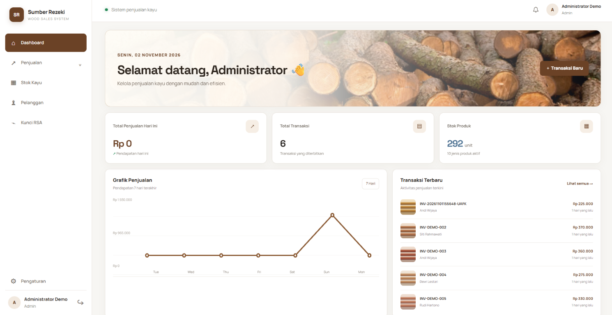

# Sumber Rezeki — Wood Sales System

Sistem manajemen penjualan kayu berbasis Laravel untuk membantu admin dan kasir mengelola produk, stok, pelanggan, dan transaksi dalam satu aplikasi. Setiap transaksi dapat diterbitkan sebagai invoice PDF dengan QR code dan tanda tangan digital agar integritas invoice dapat diverifikasi.

## Tampilan aplikasi



## Fitur

- Dashboard ringkasan penjualan, transaksi, dan stok.
- Pengelolaan produk kayu, harga, stok, dan data pelanggan.
- Pencatatan transaksi penjualan dengan validasi stok.
- Penerbitan invoice PDF, QR code, hash SHA-256, dan tanda tangan RSA-PSS.
- Halaman verifikasi invoice publik menggunakan token.
- Hak akses admin dan kasir, termasuk pengelolaan kunci RSA khusus admin.
- Audit aktivitas penting.

## Teknologi

- PHP 8.2+ dan Laravel 12
- SQLite untuk pengembangan lokal; MySQL 8+ direkomendasikan untuk deployment
- Node.js dan npm untuk build asset frontend
- Pest untuk pengujian

## Menjalankan secara lokal (Windows PowerShell)

Pastikan PHP beserta ekstensi OpenSSL, PDO SQLite, Mbstring, XML, Ctype, JSON, dan Fileinfo, Composer, Node.js, serta npm sudah terpasang.

```powershell
composer install
if (-not (Test-Path .env)) { Copy-Item .env.example .env }
php artisan key:generate
if (-not (Test-Path database\database.sqlite)) { New-Item -ItemType File -Path database\database.sqlite }
php artisan migrate
npm ci
npm run build
php artisan serve
```

Buka `http://127.0.0.1:8000`. Untuk membuat data contoh dan akun demo, jalankan `php artisan db:seed` pada lingkungan lokal saja. Seeder membuat akun demo dengan kredensial bawaan; jangan gunakan atau jalankan akun tersebut di production.

## Pengujian

```powershell
php artisan test
```

## Deployment dan keamanan

Panduan konfigurasi production, database MySQL, dan pengelolaan `APP_KEY` tersedia di [docs/deployment.md](docs/deployment.md). Jangan commit `.env`, kredensial, private key, atau database lokal ke repository. Private key aplikasi dienkripsi menggunakan `APP_KEY`; simpan dan backup key tersebut melalui secret manager.

## Dokumentasi

- [Analisis sistem](docs/phase-1-analysis.md)
- [Diagram sistem](docs/diagrams.md)
- [ERD](docs/erd.mmd)
- [Panduan deployment](docs/deployment.md)
