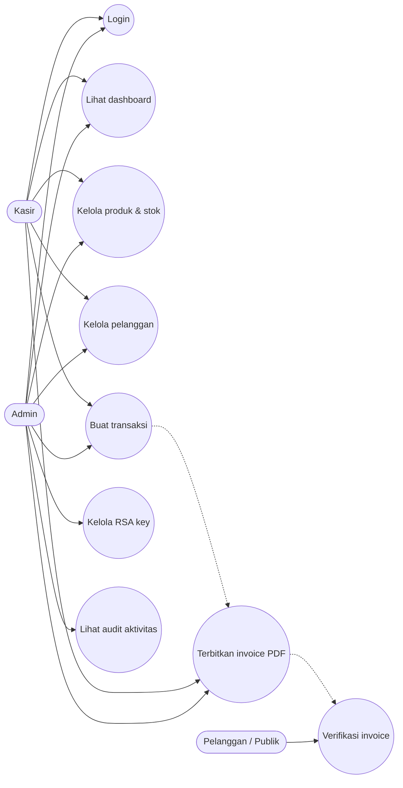
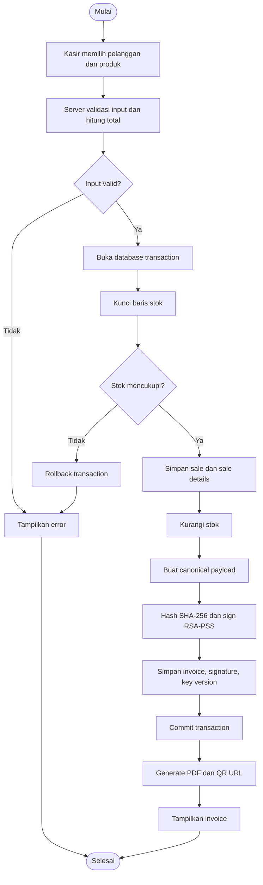
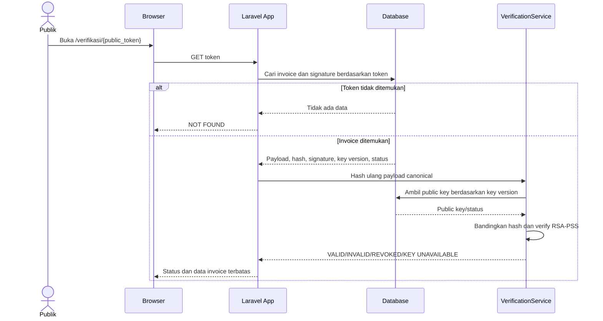
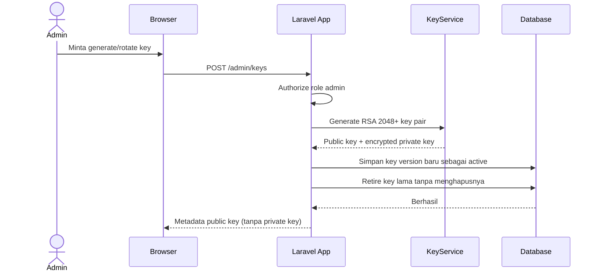

# Diagram Perancangan

Diagram menggunakan Mermaid dan dapat dirender di GitHub, VS Code extension Mermaid, atau Mermaid Live Editor.

## Use Case Diagram

## Activity Diagram — Transaksi dan Penerbitan Invoice

## Sequence Diagram — Verifikasi Publik

## Sequence Diagram — Rotasi RSA Key

